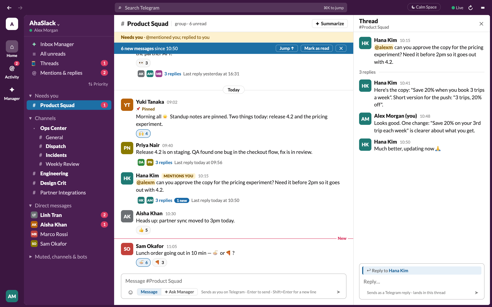
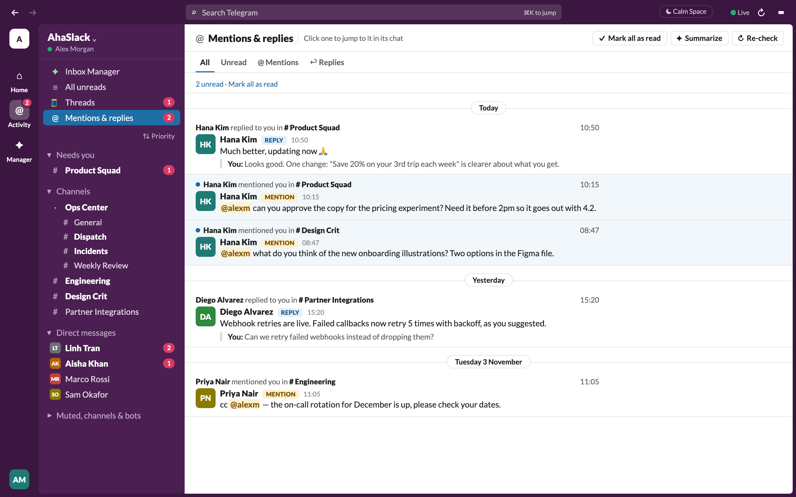
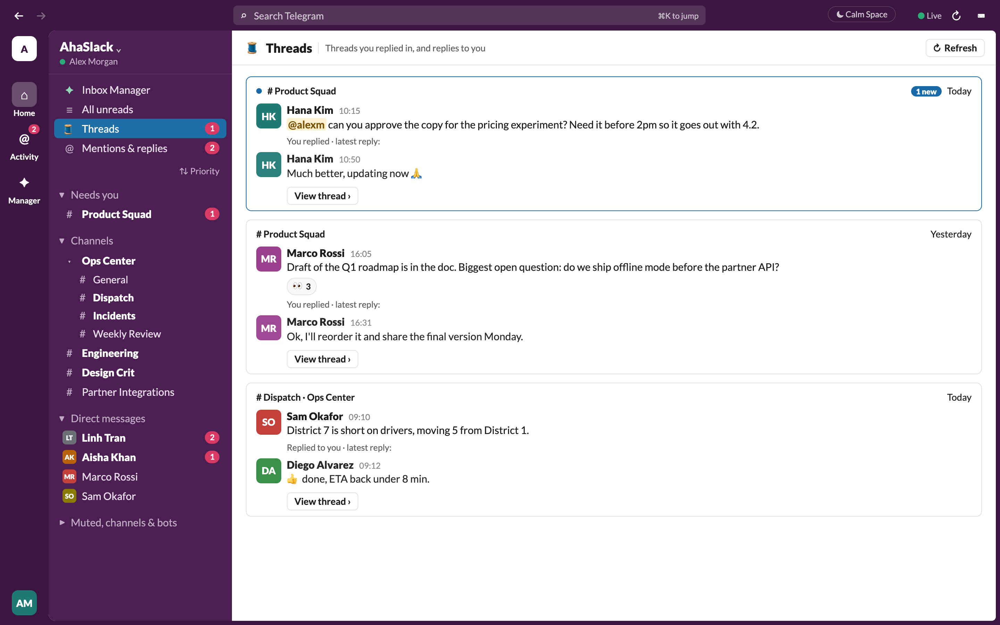
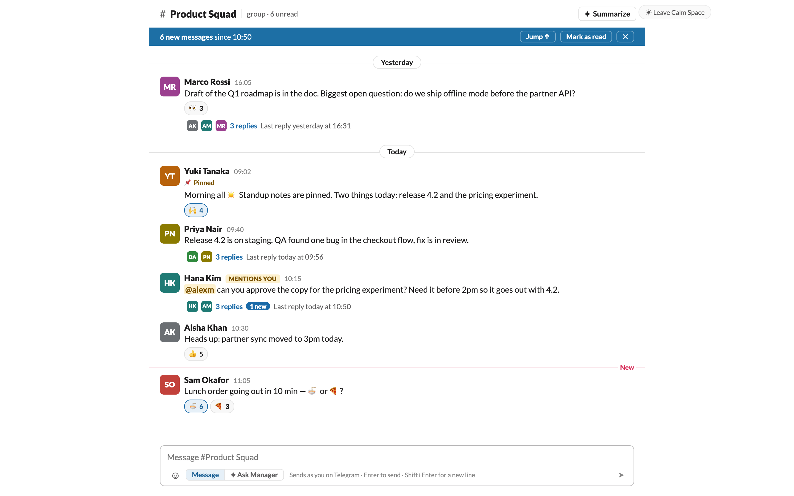
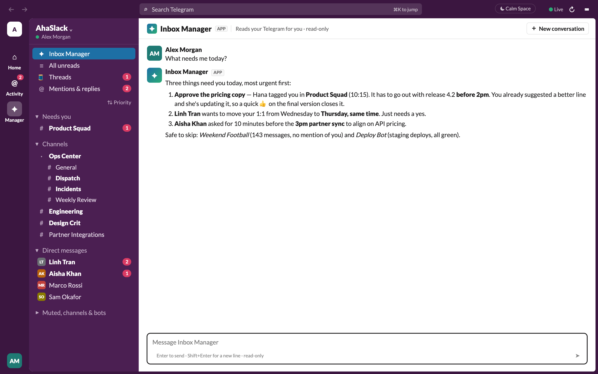
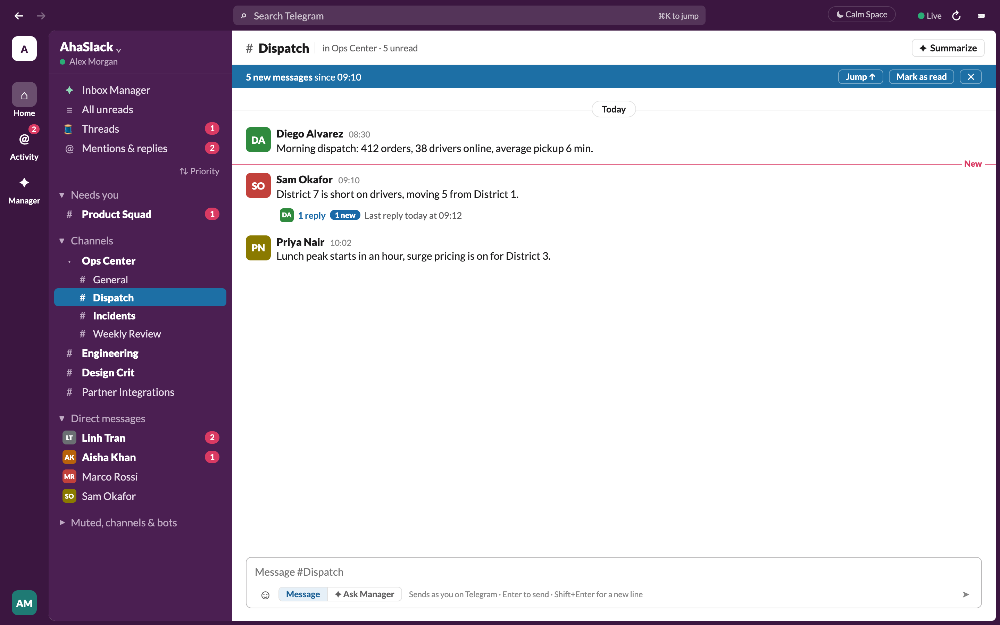

<div align="center">

# AhaSlack

**Your Telegram, organized like Slack.**<br>
Threads, a Mentions inbox, DMs kept apart from groups, a Calm Space for focus, and an AI
inbox manager. Runs on your Mac with your own Telegram login.


<picture>
  <source media="(prefers-color-scheme: dark)" srcset="docs/screenshots/hero-dark.png">
  
</picture>

<sub>Screenshots use the built-in demo mode: every person and message in them is made up.</sub>

</div>

---

## Why AhaSlack?

Telegram is great for talking and hard for keeping track. In a busy work account, the messages
that need you get buried under group chatter, replies scatter through the history, and every
group looks as urgent as your boss's DM. AhaSlack keeps Telegram as the network and adds the
parts of Slack that make a busy inbox manageable.

| | Telegram | AhaSlack |
|---|---|---|
| **Mentions & replies** | An @ badge per chat; scroll to find each one | One **Activity** inbox for every mention and reply to you, across all chats. Kept for good, read on view, badge always right |
| **Threads** | Replies are quotes in a long timeline | Replies are **grouped into threads** under the message they answer, with a *N replies* bar, and open in a side pane |
| **DMs vs groups** | One mixed list, sorted by time | **Needs you**, **Channels** and **Direct messages** sections; muted chats, channels and bots tucked away |
| **Calm Space** | — | Hide everything except the conversation you're in |
| **AI inbox manager** | — | Ask *"what needs me today?"* and get a prioritized answer with links (read-only) |

## Features that Telegram doesn't have

### 🔔 Mentions & replies: one inbox for everything addressed to you



- Every **@mention** of you and every **reply to your messages**, from all your chats, in one
  list, newest first, with the message you were replying to quoted underneath.
- **Nothing disappears.** The history is stored in a local database (`inbox.db`), not just the
  last few days.
- **Read on view, like Slack:** a mention counts as read after it has been on screen for a
  moment, and Telegram's @ badge for that message clears too. **Mark unread** to keep one
  around, or **Mark all as read**.
- Filter by **Unread**, **@ Mentions** or **↩ Replies**. Click any item to jump to it in its chat
  (or thread). Reply inline, or ask the Inbox Manager about it.

### 🧵 Threads: replies grouped under the message they answer



- In a channel, replies fold under their parent message as a **"3 replies · Last reply 10:50"**
  bar with the participants' avatars, so the main timeline stays readable.
- Open a thread and it slides in on the right, with **its own message box**. What you send
  there is a normal Telegram reply, so it lands in the same thread for everyone else.
- The **Threads** view lists every thread you're in (you replied, or someone replied to you),
  with a badge for new replies.
- Grouping is **rule-based** today: Telegram reply chains, plus someone's quick follow-up
  right after their own thread reply (marked *AUTO*; one click moves it back, and the
  correction is remembered). There's a hook ready for a small local model to classify messages
  into threads later.
- Prefer Telegram's way? Turn threads off in Preferences (**⌘,**) to show replies inline again.

### 💬 Direct messages kept apart from groups

The sidebar works like Slack's (see the screenshot at the top):

- **Needs you:** groups where someone mentioned you, replied to you or said your name.
- **Channels:** your groups. A group with **Topics** becomes a section, and each topic is its own
  `# channel` with its own unread count.
- **Direct messages:** one-to-one chats, with avatars.
- **Muted, channels & bots:** everything that can wait, collapsed.

Sort by priority, recent activity or A→Z, show only unreads, **⭐ star** what matters, and
**ignore** noisy groups. Your Telegram folders work like Slack workspaces.

### 🌙 Calm Space: just the conversation



One click (or **⌘⌥C**) hides the sidebar, the rail and every badge, leaving only the chat
you're in, so you can read and write without the rest of the inbox pulling at you.

### ✦ Inbox Manager: ask your inbox what matters



Ask in plain words: *"What needs me today?"*, *"Who tagged me and what do they want?"*,
*"What did I miss in #Engineering?"*. It reads your chats and answers with priorities and
links into the app, and can draft replies for you to send. It runs on Claude through your
Claude Code login. **It can only read**: it has no tool that sends, edits or marks anything.

## And everything you'd expect from a Slack client

- **Live sync:** new messages, edits, deletes and read states arrive as they happen, with
  desktop notifications for DMs and mentions and an unread count on the Dock icon.
- **Reading like Slack:** start where you left off, a *New* divider, an unread banner,
  **⌘J** to jump to the first unread, **Esc** to mark a chat read, **⇧Esc** for everything.
- **Search** messages, channels and people (**⌘G**; **⌘F** in this chat) and **⌘K** to jump
  anywhere.
- **Messages:** reply, edit, delete, unsend (**⌘Z**), forward, pin, react, remind me, and upload
  or drag in files.
- **Stickers, emoji and gifts:** your own sticker sets, custom emoji, and animated (Lottie) and
  video stickers inline. Gifts are view-only.
- **Keyboard first:** Slack's full shortcut list, every one rebindable from **⌘/**.
- **Telegram Topics as channels:** each topic gets its own messages, composer and mark-read.



## Try it without a Telegram account

Start the server (see [Run](#run)) and open <http://127.0.0.1:8765/?demo>. Demo mode fills the
app with a made-up team and never contacts Telegram. You can also open a specific screen:
`?demo=hero`, `mentions`, `threads`, `calm`, `manager` or `topics`. These are the screens in
the screenshots above.

## Requirements

- macOS for the desktop app (the web version runs anywhere Python does)
- [uv](https://docs.astral.sh/uv/) for Python: `curl -LsSf https://astral.sh/uv/install.sh | sh`
- A Telegram account and an API id/hash from <https://my.telegram.org> → *API development tools*
- For the Inbox Manager: [Claude Code](https://claude.com/claude-code) installed and logged in
  (it uses your Claude Code login; no API key needed)
- To build the desktop app: Node.js 18+

## Set up

```bash
git clone https://github.com/RectorPh/AhaSlack.git && cd AhaSlack
uv run --script login.py          # api_id, api_hash, phone, the code Telegram sends, 2FA
```

Login stores everything in `~/.config/telegram-inbox/` (owner-only). It also creates
`~/.config/telegram-inbox/config.toml`: put your name and handle in `my_keywords`, your
timezone in `timezone`, and turn on `sending_enabled` / `mark_read_enabled` if you want to
send and mark read from the app (both are off by default).

## Run

**Desktop app (macOS):**

```bash
cd electron && npm install && npm run dist   # builds electron/dist/mac-arm64/AhaSlack.app
open dist/mac-arm64/AhaSlack.app
```

The app starts the local server for you and stops it when you quit. If you haven't logged in
yet, it opens Terminal to do it. The app is unsigned, so the first time, right-click it and
choose **Open**. Server logs are in `~/Library/Logs/AhaSlack/`.

**In a browser:**

```bash
uv run --script server.py         # then open http://127.0.0.1:8765
```

**Command line (no UI):** `uv run --script fetch_inbox.py` writes a triage snapshot to
`~/.cache/telegram-inbox/latest.txt`; `--hours 12` covers everything from the last 12 hours,
and `--chat "name"` focuses on one chat.

## How it fits together

```
login.py         one-time Telegram login (Telethon user API)
server.py        local web server (FastAPI, 127.0.0.1 only) + the page in static/
live.py          real-time sync: Telegram events -> in-memory state -> the page (SSE)
db.py            local database: Activity (mentions & replies) and threads you're in
tg.py            Telegram access: chats, threads, triage snapshot, mentions, search, actions
stickers.py      your stickers, custom emoji and gifts
triage.py        "needs you / worth a look / ignore" rules
agent.py         the Inbox Manager (Claude Agent SDK, read-only Telegram tools)
fetch_inbox.py   the command-line snapshot
static/          the app: app.js, threads.js, live.js, slack.js, picker.js, demo.js
electron/        the AhaSlack macOS app
```

## Safety & privacy

- **Your login never leaves your Mac.** `~/.config/telegram-inbox/inbox.session` is a full
  login to your Telegram account, so never share or commit it. To revoke it, run
  `uv run --script login.py --logout`, or go to Telegram → Settings → Devices.
- **No third-party server.** AhaSlack talks to Telegram directly with the official user API.
  Your messages are only sent anywhere else when you ask the Inbox Manager, which sends what it
  reads to Claude.
- **The server only listens on 127.0.0.1** and refuses requests from other websites (Host check,
  custom header, Origin check), so a web page can't use it to send messages as you.
- **Only you change Telegram.** Sending, editing, deleting, reacting and marking read happen only
  when you act in the app, and only if you turned them on in `config.toml`. Deleting asks first.
- **The Inbox Manager is read-only**, and treats message text as data, never as instructions.

## Tests

```bash
uv run --with pytest --with telethon python -m pytest tests
```

## License

MIT. Not affiliated with Slack or Telegram.
